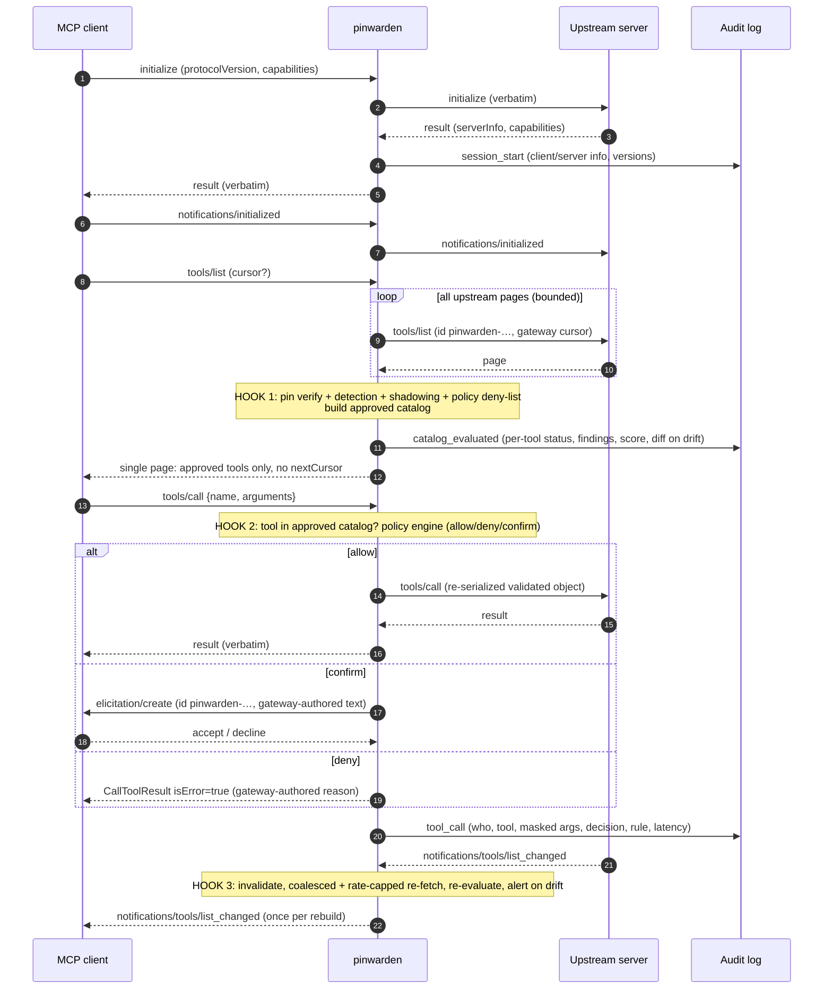

# Architecture

Status: Accepted (maintainer, 2026-11-05) — living document, revised each phase. Decisions referenced here are recorded in `docs/adr/`.

## 1. One-paragraph summary

`pinwarden` is a **message-level JSON-RPC relay** that sits between one MCP client and one
upstream MCP server. Every frame is parsed strictly (no duplicate keys, no `NaN`; ADR-0006)
and forwarded verbatim, except for a small set of **intercepted methods** (`initialize`,
`tools/list`, `tools/call`, `notifications/tools/list_changed`) which it parses with typed
models, checks, and may rewrite or answer itself. Everything it sees is written to a JSONL audit log. When in doubt it
**fails closed** (ADR-0005). The trust anchor is `mcp.lock`, a file of canonical hashes of
human-approved tool schemas (ADR-0004).

## 2. Deployment model

- **stdio (phase 1).** The client config points at `pinwarden run --server <name>` instead of
  the real server command. The gateway reads `gateway.yaml`, spawns the real server as a child
  process, and relays newline-delimited JSON-RPC between its own stdin/stdout and the child's.
  **One gateway process per upstream server** — this is how clients spawn stdio servers.
- **Streamable HTTP (phase 2).** The gateway listens on `127.0.0.1:<port>` (never `0.0.0.0` by
  default; `Origin` checked against DNS rebinding) and reverse-proxies to the upstream URL.
  `Mcp-Session-Id` and `Authorization` headers pass through untouched; responses may be plain
  JSON or an SSE stream, and SSE events are parsed so intercepted responses can be filtered.
- **Cross-server knowledge** (needed for shadowing detection) comes from `mcp.lock`, which
  holds the pinned tools of *all* configured servers. Gateway instances do not talk to each
  other.

## 3. Module layout

```
src/pinwarden/
  cli.py                 argparse entry: run | approve | scan | diff | check-config
  config.py              Pydantic models for gateway.yaml (servers, mode, paths, limits)
  proxy/
    framing.py           stdio newline-JSON reader/writer, size limits (default 16 MiB/msg)
    transport_stdio.py   child process spawn, stdin/stdout pumps, stderr passthrough
    transport_http.py    phase 2: Starlette app + httpx upstream client, SSE parse/re-emit
    session.py           per-connection state: pending-request table, catalog cache, ids
    interceptor.py       method dispatch -> hooks; everything else = passthrough
    messages.py          strict JSON parse (dup keys/NaN rejected), envelope model, typed parse
  pinning/
    canonical.py         tool -> canonical bytes (RFC 8785 JCS) -> SHA-256
    lockfile.py          load/validate/write mcp.lock (atomic write, schema-versioned)
    verifier.py          compare live tool vs pin -> PINNED_OK | DRIFT | UNPINNED
    diff.py              JSON-pointer diff + unified text diff for long strings
  detection/
    findings.py          Finding(rule_id, severity, tool, json_pointer, evidence, explanation)
    walker.py            walk every string in the tool object (all nested schema fields)
    rules/poisoning.py   instruction-like patterns, hidden tags, exfil hints, cross-tool refs
    rules/unicode.py     invisible/bidi/tag chars, mixed-script & TR39 confusables
    rules/shadowing.py   exact / normalized / confusable name collisions across servers
    scorer.py            explainable score = sum of weighted findings, capped, with breakdown
    data/confusables.json  vendored, generated subset of Unicode TR39 confusables
  policy/
    model.py             Pydantic v2 policy schema (extra="forbid")
    loader.py            YAML (safe_load) -> model; errors are fatal at startup
    engine.py            evaluate(server, tool, args) -> Decision(allow|deny|confirm, rule_id)
    constraints.py       path allowlist (THREAT_MODEL T4), domain allowlist, regex, enum — by JSON pointer
    confirm.py           human confirmation via MCP elicitation (see §6)
  audit/
    events.py            AuditEvent model (OTel log-data-model compatible fields)
    masking.py           secret masking (key names + value patterns)
    sink_jsonl.py        append-only JSONL writer, fsync policy, rotation by size
    otel.py              optional OTLP exporter (extra `otel`), no-op if not installed
```

`pinning`, `detection`, `policy`, `audit` are **pure, synchronous, I/O-free cores** (except
lockfile/YAML loading and the sink). All of `src/` is type-checked with `mypy --strict`
(CLAUDE.md). `proxy` is the only async, I/O-heavy package. This keeps most of the logic unit-testable without processes.

## 4. Message flow



## 5. Hooks

| Hook | Trigger | Controls | Output |
|---|---|---|---|
| H0 `initialize` | client request + server response | record versions/capabilities; note whether client supports `elicitation` | audit only, no rewrite |
| H1 `tools/list` | client request | gateway walks **all** upstream pages itself, then runs pinning → detection → shadowing → policy tool deny-list over the full set | one response containing only approved tools |
| H2 `tools/call` | client request | name ∈ approved catalog; policy (server/tool allow/deny, argument constraints, confirm) | forward the **re-serialization of the validated object** (ADR-0006), or gateway-authored refusal |
| H3 `list_changed` | server notification | invalidate + coalesced, rate-capped re-fetch + re-evaluate; drift → alert | one notification to client per rebuild |
| H4 unknown `tools/*` | either direction | method or notification under `tools/` / `notifications/tools/` not listed above | enforce: deny (JSON-RPC error / drop); monitor: forward |
| H* audit | every message | metadata for all; full masked args for `tools/call` | JSONL event |

**Runtime catalog rule (enforce mode).** A tool is exposed iff: `PINNED_OK` (hash matches
`mcp.lock`; a tool whose hash cannot be computed is `UNPINNED`) **and** its name is unique
within this server's `tools/list` (a duplicate hides **every** tool with that name + alert)
**and** it does not collide with another server's pinned tool name (unless the
policy explicitly allows the collision) **and** policy does not deny it. Detection findings on an
already-pinned tool are logged but do not hide it — the human accepted them at approval time.
Detection is decisive at **approval time**: `pinwarden approve` refuses tools whose risk score
exceeds the threshold unless the user passes `--accept-rule <rule_id>` per finding.

**Pagination.** The gateway owns pagination towards the upstream: it follows `nextCursor` until
exhausted (limits: 50 pages, 2 000 tools, 30 s total; any limit hit = fail closed with an error)
and returns a single page to the client. Rationale: pinning, shadowing and scoring need the full
set, and a single page is valid MCP. If a client sends a `cursor` the gateway never issued, it
returns `-32602 Invalid params`.

**Strict parsing / no parse differential (ADR-0006).** Frames are decoded with duplicate-key
rejection (`object_pairs_hook`) and `NaN`/`Infinity` rejection (`parse_constant`) → JSON-RPC
error, never forwarded. Policy evaluates the parsed `tools/call`, and the gateway forwards
`json.dumps` of that same object: what was checked is exactly what is sent.

**`list_changed` flood.** Notifications are coalesced: at most one rebuild in flight; any
notification during it marks the catalog dirty and triggers exactly one follow-up rebuild.
Rebuilds are rate-capped by `limits.list_changed_min_interval` (default 2 s — a configured
default, not a measured value). `tools/call` waits for a pending rebuild (bounded by that
interval). One audit event per rebuild records the number of coalesced notifications.

**Calls to tools never listed.** If `tools/call` arrives before any `tools/list`, the gateway
builds the catalog first (H1 internally) and then evaluates. The catalog is the single source
of truth for H2.

**Drift handling.** Drift is detected whenever a catalog is (re)built. The drifted tool is
removed from the catalog, an `ERROR` audit event with the diff is written, a one-line alert goes
to stderr (visible in client logs), and calls to it return an `isError` result telling the user
to run `pinwarden diff <server>`. The drifted text is **never** echoed to the client/LLM.

## 6. Human confirmation

For policy rules with `action: confirm`, the gateway sends an `elicitation/create` request to
the client (only if the client declared the `elicitation` capability at `initialize`). The
message is gateway-authored (tool, server, truncated arguments, matched rule) and never includes
server-provided text.

**Id namespace (ADR-0006).** *All* gateway-originated requests, in both directions
(`elicitation/create` to the client, `tools/list` page fetches to the server), use ids
`pinwarden-<uuid4>`. Peer requests using that prefix are rejected (`-32600`); unknown
`pinwarden-` responses are dropped and audited. No elicitation capability → deny (enforce) / log (monitor).
Timeout 120 s → deny. Out-of-band confirmation (OS notification, TTY) is roadmap.

## 7. Fail-closed behaviour (summary of ADR-0005)

| Condition | enforce | monitor |
|---|---|---|
| `gateway.yaml` / policy invalid | exit non-zero at startup | same |
| `mcp.lock` missing or corrupt | start; expose **no** tools; stderr hint | expose all, log |
| tool unpinned / drifted | hidden; calls refused | exposed; `WARN`/`ERROR` event |
| tool hash cannot be computed (`rfc8785` raises: int beyond ±2^53, lone surrogate) | treated as `UNPINNED`: hidden, `ERROR` event (never a hook crash) | exposed; `ERROR` event |
| same tool name twice in one server's `tools/list` | hide **all** tools with that name; alert | forwarded as received; `ERROR` event |
| unparseable message, duplicate keys, `NaN`/`Infinity` | JSON-RPC error to sender, not forwarded | same (protocol safety) |
| JSON-RPC batch (array) | JSON-RPC error, not forwarded | same (protocol safety) |
| peer id with `pinwarden-` prefix | rejected `-32600` | same (protocol safety) |
| unknown method under `tools/*` / `notifications/tools/*` | deny (error / drop) | forward; `would_deny` event |
| hook raises / times out | deny | forward unchanged after recording `decision=error` (audit, or stderr if sink down) — monitor never blocks |
| message > size limit | drop + error; close if framing lost | same |
| audit sink write fails | deny `tools/call` | allow + stderr |
| upstream exits | gateway exits with same code | same |

Monitor mode is the *only* way to relax fail-closed, and it is logged on every event.

## 8. Concurrency model

- One `asyncio` event loop per gateway process; `anyio`-compatible where the SDK requires it.
- Two pump tasks per connection (client→server, server→client) reading framed messages.
- Non-intercepted messages are forwarded inline by the pump (no task spawn, minimal latency).
- Intercepted requests spawn a task so a slow confirmation never blocks other traffic. One
  `pending` table per direction, keyed by **`(json_type, raw_value)`** of the id so `1`, `1.0`
  and `"1"` stay distinct (`→ method, start_ns, parsed params`), correlates responses; entries
  are removed on response or `notifications/cancelled`.
- Catalog rebuilds are serialized by an `asyncio.Lock`; `tools/call` waits for an in-flight
  rebuild (no evaluation against a stale catalog).
- Writes to each output stream go through a single writer task with a bounded queue
  (backpressure, no interleaved frames). Audit writes go through their own queue.
- CPU-bound work (JCS + SHA-256 + regex rules on ≤2 000 tools) is small; it runs inline.
  Regexes are linear-time patterns only, with input length caps (ReDoS).

## 9. Pure passthrough (not inspected, only audited as metadata)

`ping`, `resources/*`, `prompts/*`, `completion/complete`, `logging/*`, `notifications/*` other
than `tools/list_changed`, server→client requests (`sampling/createMessage`,
`elicitation/create`, `roots/list`), and **any unknown method outside `tools/*` /
`notifications/tools/*`** (forward-compat, ADR-0003); unknown tool-namespace methods are H4.
Responses to `tools/call` are forwarded unmodified — tool *results* are not scanned in the MVP
(see THREAT_MODEL §7). Resource/prompt descriptions are a known poisoning vector; scanning them
is roadmap.

## 10. Configuration files

- `gateway.yaml` — servers (`name`, `command`/`args`/`env` or `url`), `mode`, paths, limits.
- `policy.yaml` — may be inlined in `gateway.yaml`; validated by `policy/model.py`.
- `mcp.lock` — next to `gateway.yaml` by default (`--lock` to override). See ADR-0004.
- Default location: `$XDG_CONFIG_HOME/pinwarden/` (Windows: `%APPDATA%\pinwarden\`).

## 11. Benchmark hooks

`bench/` drives the gateway in-process and over stdio against fixture servers in `attacks/`
(malicious) and pinned legitimate servers (≥10 servers, ≥50 tools). Latency is measured as
gateway-added time per `tools/call` (`pending` timestamps), reported p50/p95 over N≥200 calls.
